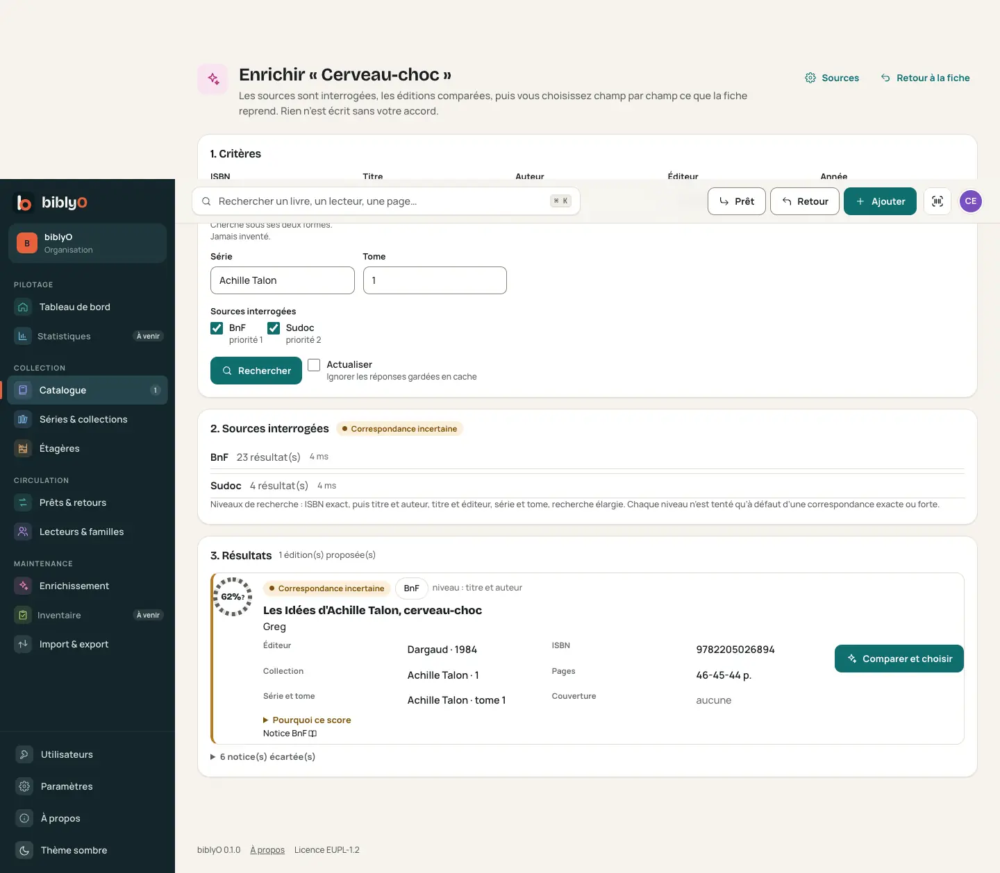
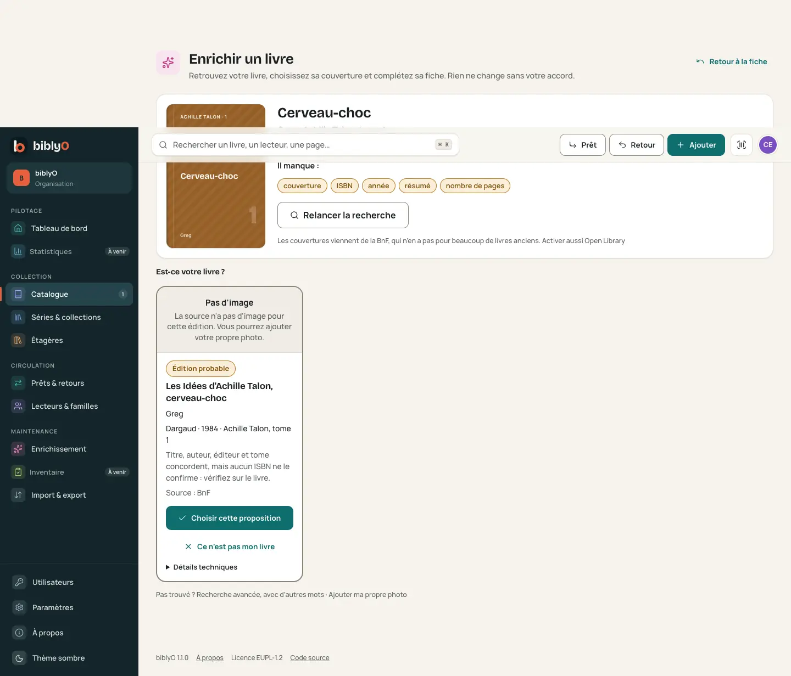
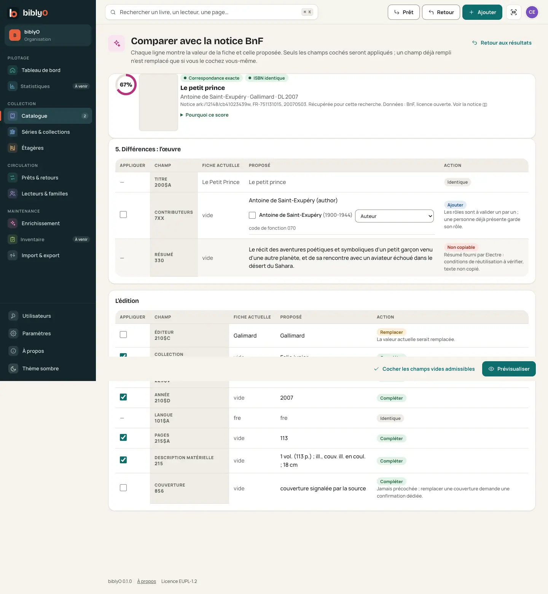
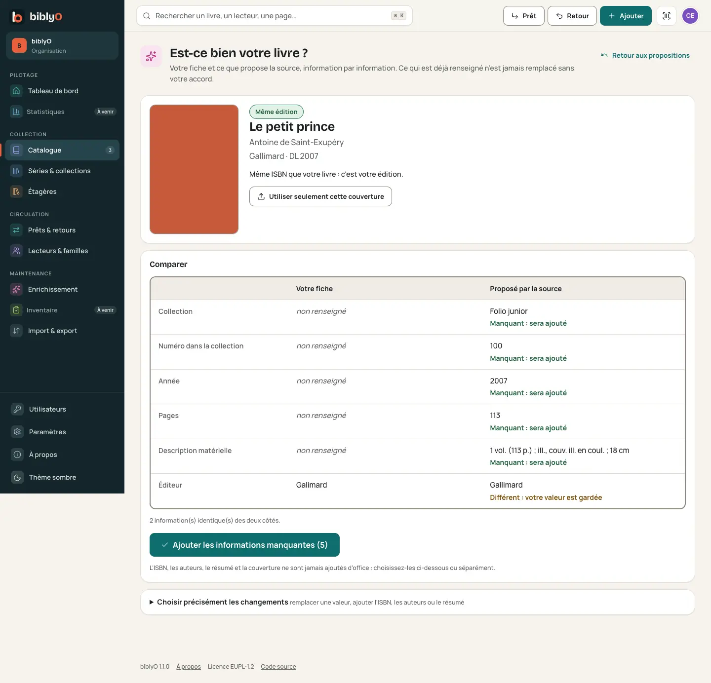
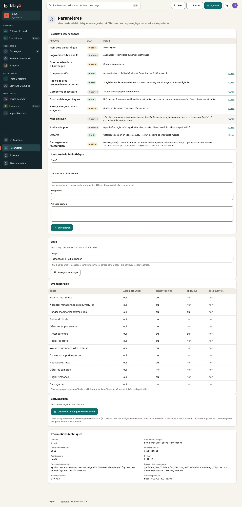
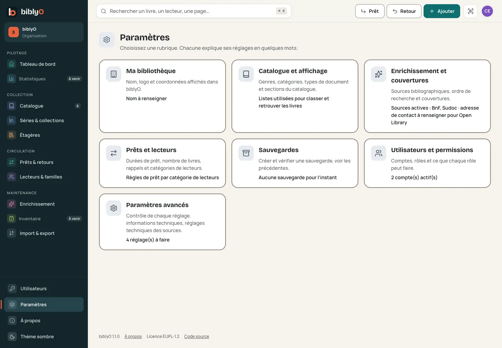
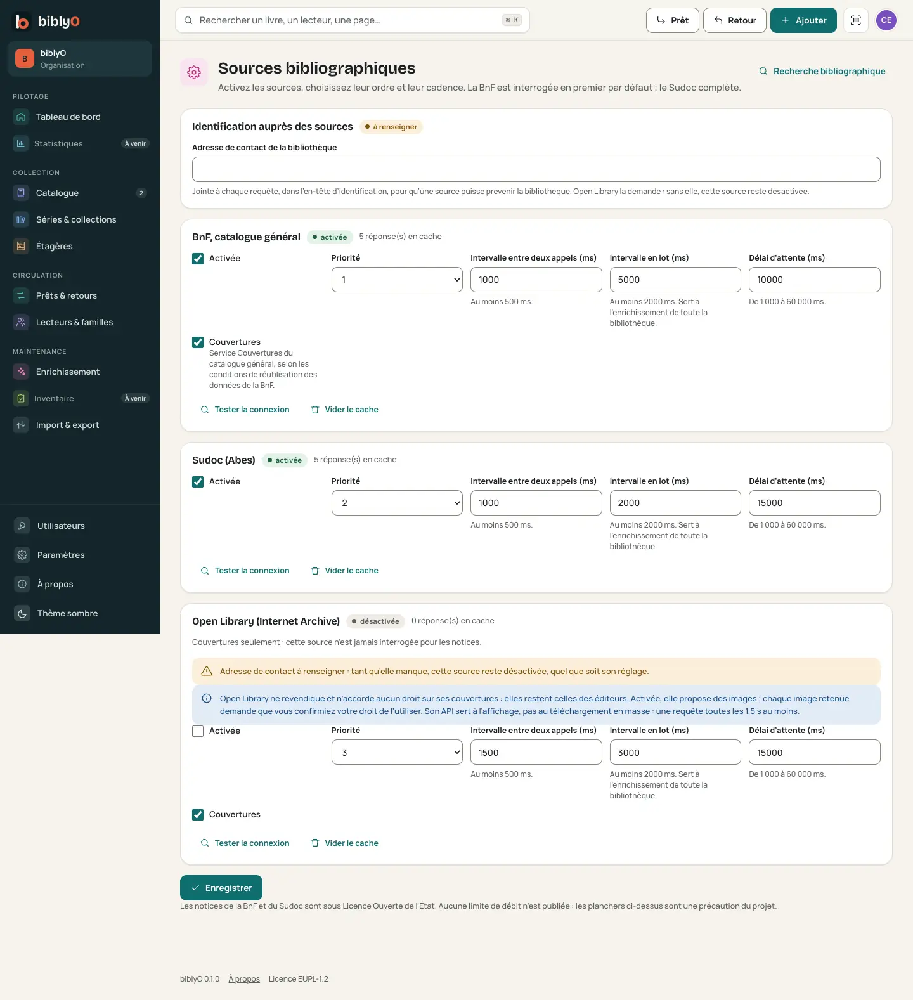
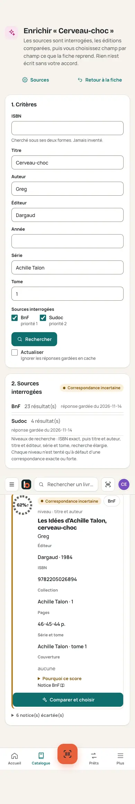

# Recette de biblyO 1.1.0

Version 1.1.0 : enrichissement assisté, couvertures visibles, enrichissement de toute la bibliothèque (révision 0013),
paramètres par rubriques. Code d'origine : `main@f0764c9` du dépôt de développement. Toutes les vérifications ci-dessous
utilisent des **données inventées** et des réponses publiques enregistrées de la BnF, du Sudoc et d'Open Library
(métadonnées seulement, aucune image conservée).

## 1. Ce qui a été corrigé

| Défaut | Cause | Correction |
|---|---|---|
| Les notices sont trouvées, leurs couvertures pas montrées | L'écran de résultats n'affichait qu'un texte « couverture signalée » | Chaque proposition montre la vraie couverture servie par la source, ou « Pas d'image » |
| Recherche de couvertures séparée | L'écran Couverture refaisait ses propres requêtes, sans série ni tome | Une seule recherche ; couvertures tirées des notices trouvées ; Open Library dans le même appel |
| « Aucune couverture » pour les bandes dessinées anciennes | La BnF ne sert une image que pour les notices qui l'annoncent (vérifié : 7 notices sans annonce sur 7 n'en servent aucune) | Constat expliqué à l'écran ; Open Library proposée en complément, sous conditions |
| Titres abrégés de bande dessinée mal reconnus | « Cerveau-choc » contre « Les Idées d'Achille Talon, cerveau-choc » : titre « seulement cohérent » | Deux formes reconnues, jamais plus que « très proche » |
| Écran technique | Anneaux de score, tableaux, cases à cocher par champ | Cartes, indications en mots, comparaison simple ; score dans « Détails techniques » |
| Paramètres longs et techniques | Une page unique, cadences en millisecondes au premier plan | Sept rubriques, réglages techniques repliés |

## 2. Cas réels de bandes dessinées

| Cas | Résultat |
|---|---|
| « Cerveau-choc », Achille Talon, Greg, Dargaud | Première proposition : « Les Idées d'Achille Talon, cerveau-choc » (Dargaud, 1984), **Édition probable**, « Pas d'image » (la BnF n'en a pas). La seule couverture BnF disponible (« Achille Talon » tome 1, Dargaud 2007) n'est **jamais** proposée ; les autres tomes sont écartés. Avec Open Library : la couverture de l'album est proposée à part, « Autre édition — couverture à vérifier » ; l'« Intégrale d'Achille Talon, tome 1 » ne l'est jamais. Compléter la fiche exige « J'ai vérifié : c'est bien mon livre » |
| « Du scénario à la réalisation », Duc, Glénat | Éditions **1981 et 1990** côte à côte, « À vérifier », « Plusieurs éditions se ressemblent : comparez l'année et l'éditeur » (le Sudoc leur donne le même ISBN) |
| Tome de série | Un autre numéro de tome est toujours écarté |
| ISBN absent ou seulement proposé | Jamais « Même édition » sans ISBN confirmé identique |
| Aucun résultat | « Aucune proposition satisfaisante », « Ajouter ma photo de la couverture », « Recherche avancée » |
| Image indisponible | « Pas d'image » ou « La notice annonce une couverture, mais le service ne la fournit pas en ce moment » ; jamais une vignette cassée |

## 3. Vérifications

| Vérification | Résultat |
|---|---|
| Tests automatisés (unités, services, écrans, migrations) et contrôles du dépôt (types, indépendance, reprise de code, titulaire, gabarits, contraste, composants tiers, traductions) | **3 158 réussis** |
| Parcours dans un navigateur (Chromium), ordinateur et téléphone, contrôles d'accessibilité axe, aucun débordement horizontal | **185 réussis sur 185** |
| Mise à jour éprouvée sur une machine de recette isolée, en `linux/amd64` | **Conforme** (détail ci-dessous) |

### Mise à jour 1.0.0 → 1.1.0, puis retour arrière

1. Image publiée `ghcr.io/adsolutionpro/biblyo:1.0.0`, téléchargée sans compte (`sha256:33de2bd7…`), migrée, remplie
   par le parcours de recette (33 contrôles sur 33) ; état de chaque table relevé.
2. Image 1.1.0 à la place, mêmes volumes : **non prête (503)** tant que la base n'est pas migrée, rien de migré
   d'elle-même ; `biblyo db upgrade` : sauvegarde **pré-migration** vérifiée, puis révision 0013 ; **chaque table garde
   exactement ses lignes, numéros d'inventaire identiques** ; redémarrage : 5 contrôles sur 5, état identique.
3. Nouveaux écrans : assistant, enrichissement de la bibliothèque, paramètres, sources, sauvegardes : conformes.
4. Retour à 1.0.0 : elle **refuse la base 0013 (503) sans rien écrire** ; la restauration de la sauvegarde
   pré-migration rend **exactement** l'état de départ (révision 0012).

### Échecs rencontrés pendant la recette, et leur sort

| Moment | Échec | Sort |
|---|---|---|
| Vérification pendant une saturation du poste de développement | 4 tests visaient l'ancienne adresse des sources | Tests mis à jour ; relancés au calme : réussis |
| Premier passage des parcours navigateur | 6 sur 185 : « Retour aux propositions » perdait la recherche ; erreur serveur pendant une recherche globale en cours (« % » isolé dans un texte traduit) ; débordement de « Paramètres avancés » sur téléphone ; un parcours visait l'ancienne page | **Trois défauts corrigés** ; un test couvre désormais l'affichage pendant une recherche en cours |
| Deuxième passage | 1 sur 185 : le parcours attendait la fin d'une recherche globale qui avance au rythme réel des sources | Parcours rendu déterministe ; pause, reprise et annulation éprouvées par un test d'écran |
| Passage final | Aucun | 185 sur 185 |

## 4. Captures (données inventées)

| Écran | Avant (1.0.0) | Après (1.1.0) |
|---|---|---|
| Résultats d'une recherche |  |  |
| Comparaison |  |  |
| Paramètres |  |  |
| Sources bibliographiques |  |  |
| Téléphone |  |  |

Autres captures : `captures-1.1.0/apres-du-scenario-ordi-2-propositions.webp` (éditions de 1981 et 1990),
`apres-bibliotheque-ordi.webp` (enrichir la bibliothèque), `apres-parametres-tel.webp`, `apres-utilisateurs-tel.webp`.

## 5. Garanties

- L'enrichissement n'écrit que dans les œuvres, éditions, contributeurs et couvertures, par des opérations traçables et
  annulables ; exemplaires, numéros d'inventaire, cotes, emplacements, lecteurs, prêts, sauvegardes et traces d'import
  ne sont jamais touchés.
- Révision 0013 : deux tables nouvelles, aucune table modifiée ; appliquée seulement à la main, après une sauvegarde
  vérifiée ; descente refusée dès qu'une recherche de la bibliothèque existe (retour par la sauvegarde).
- Open Library n'est jamais appelée en lot ; aucune image n'est téléchargée en masse ; Google Books est écarté
  (ses conditions interdisent les copies permanentes et le tri de ses résultats).

## 6. Points d'attention

| Point | Portée |
|---|---|
| Couvertures des bandes dessinées anciennes | La BnF n'en a pas pour beaucoup d'entre elles ; Open Library peut compléter, une image à la fois, avec confirmation du droit d'usage, une fois l'adresse de contact renseignée (Paramètres → Enrichissement et couvertures) |
| Durée d'une recherche de toute la bibliothèque | Quelques heures pour près de 900 éditions (5 s entre deux appels à la BnF) ; la recherche avance seule et se reprend après une coupure |
| Seuils de correspondance | Inchangés ; jamais suffisants seuls pour confirmer un ISBN, une édition ou une couverture |
| Comptoir de prêt | Un clic sur une liste encore périmée, moins d'un quart de seconde après la frappe, peut voir son affichage remplacé par le résultat de la recherche ; sans effet sur les données (connu depuis 1.0.0) |
