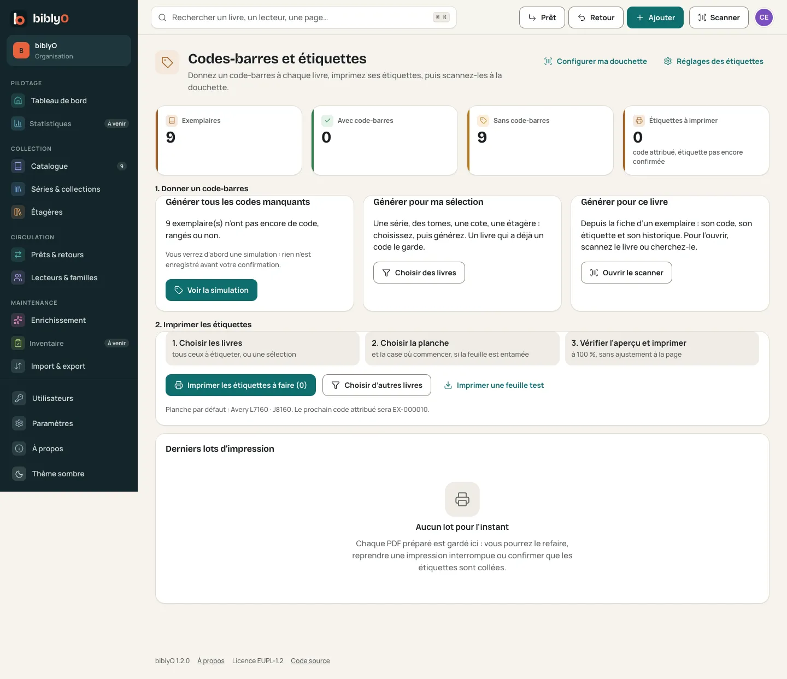
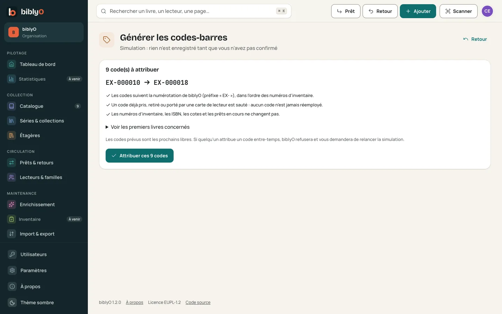
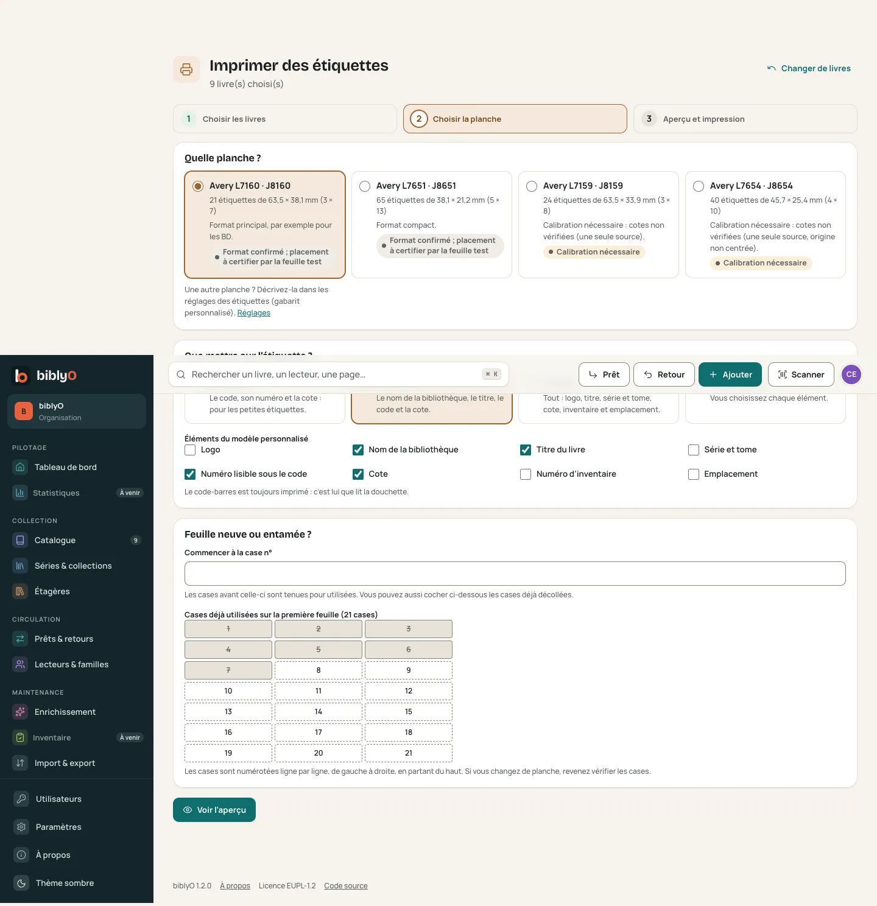
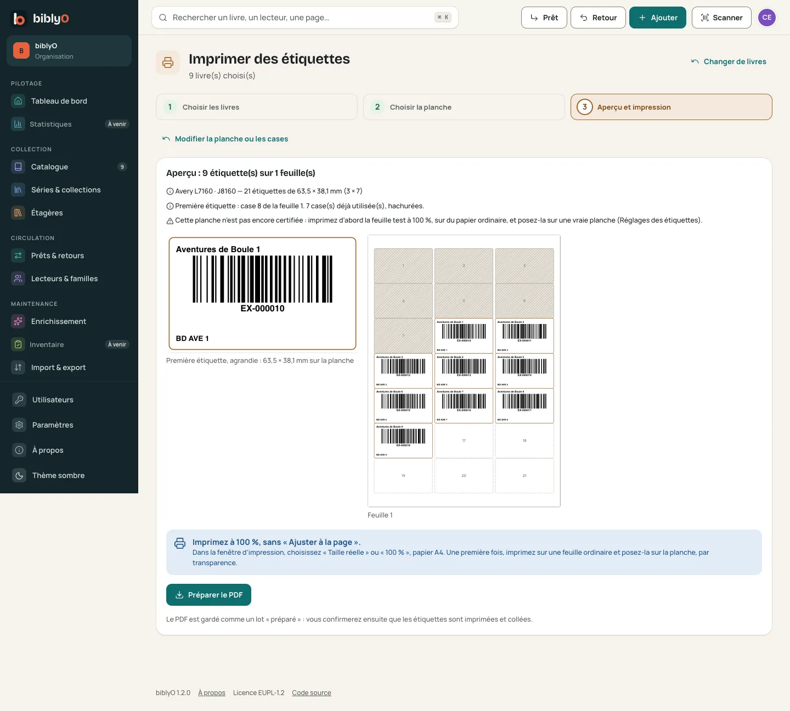
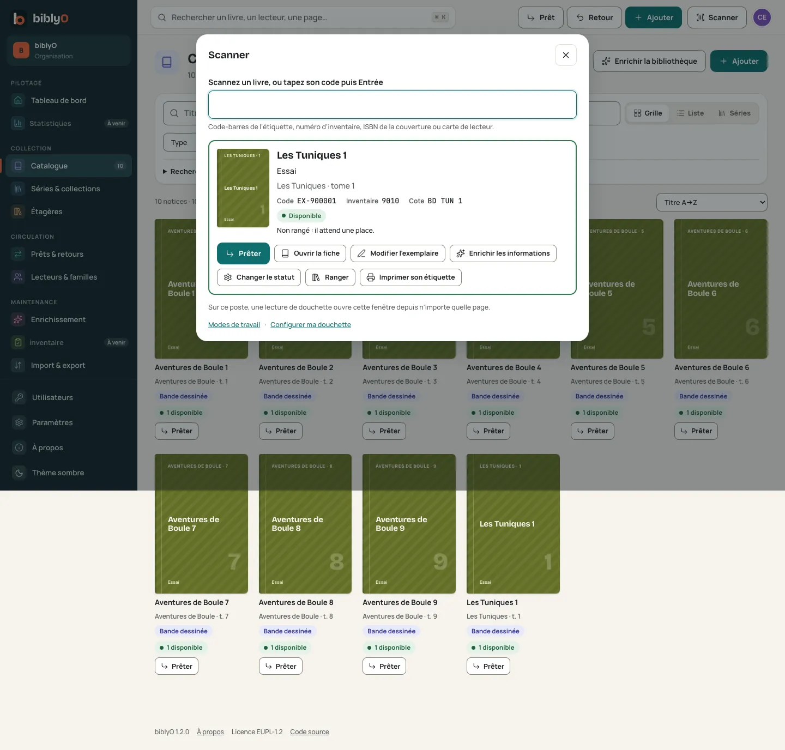
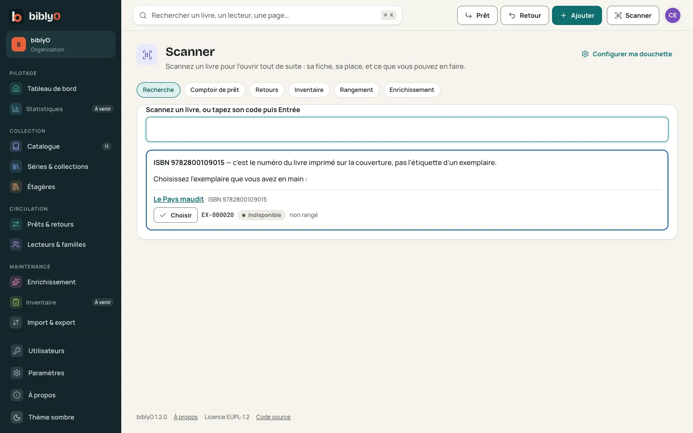
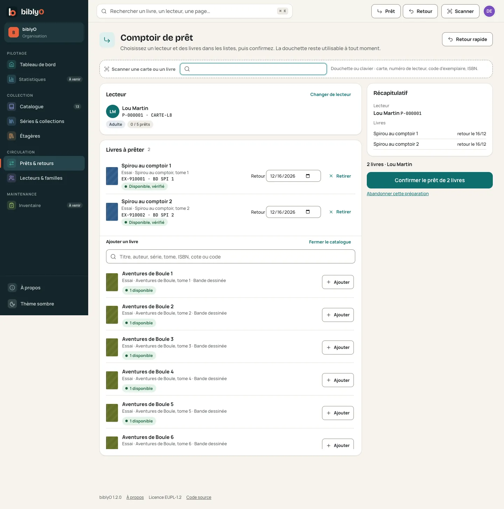
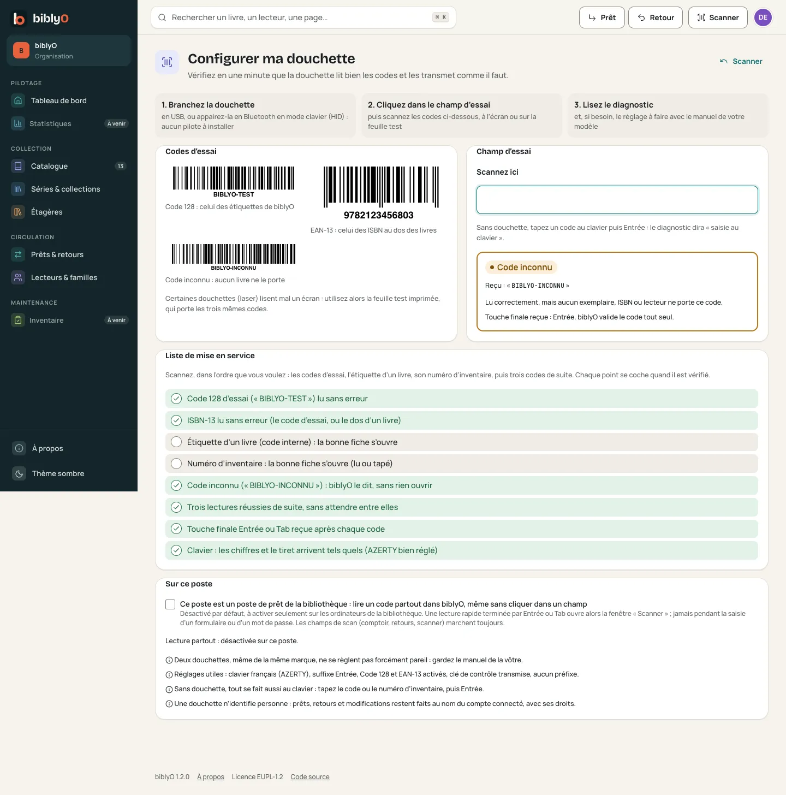

# Recette de biblyO 1.2.0

Version 1.2.0 : codes-barres, étiquettes A4 et scanner universel (révision 0014). Code d'origine : `develop@dbec4e1` du
dépôt de développement. Toutes les vérifications ci-dessous utilisent des **données inventées**.

## 1. Ce qu'apporte la version

| Besoin | Réponse |
|---|---|
| Donner un code-barres à chaque livre | « Générer tous les codes manquants » : simulation sans écriture, puis une seule opération confirmée, journalisée ; pour une sélection, ou pour un livre depuis sa fiche. Un code existant n'est jamais remplacé, un code retiré jamais réemployé ; l'inventaire, la cote et l'ISBN ne changent pas |
| Choisir la forme des codes | Préfixe réglable explicitement (`biblyo codes prefixe CSN` : `CSN000001`…), numérotation continue, codes existants inchangés |
| Imprimer sur des planches A4 | PDF produit par biblyO, A4 réel, impression à 100 % demandée au lecteur PDF ; Avery L7160 et L7651 en tête, L7159, L7654 et gabarit personnalisé ; feuille test, calibration, feuille entamée, lots refaits ou repris sans régénérer aucun code |
| Retrouver un livre à la douchette | Bouton « Scanner » permanent, fiche immédiate et actions permises ; un ISBN mène toujours à un choix d'exemplaire ; modes comptoir, retours, inventaire, rangement, enrichissement |
| Régler une douchette | « Configurer ma douchette » : codes d'essai, diagnostic, liste de mise en service en huit points ; lecture partout activée poste par poste |
| Qui fait quoi | Génération en masse : gestion du catalogue ; impression : droit « Imprimer des étiquettes », et rôle d'appoint « Impression des étiquettes » à cocher sur un compte choisi |

## 2. Vérifications

| Vérification | Résultat |
|---|---|
| Tests automatisés (unités, services, écrans, migrations) et contrôles du dépôt (types, indépendance, reprise de code, titulaire, gabarits, contraste, composants tiers, traductions, Docker) | **3 249 réussis** dans ce dépôt |
| Parcours dans un navigateur (Chromium), ordinateur et téléphone, douchette simulée (8 ms par caractère, puis Entrée ou Tab), contrôles d'accessibilité axe y compris sur les écrans remplis, aucun débordement horizontal | **196 réussis sur 196** |
| Table du Code 128 | **107 motifs sur 107** relus par un décodeur indépendant (Vision, macOS) : 110 codes d'essai, chaque valeur de 0 à 102 en clé de contrôle, départs A, B et C, changements de jeu, arrêt (`scripts/verifier_code128.py`, `preuves-l8/code128-107-motifs.txt`) |
| Planches produites | Pages de 210 × 297 mm ; chaque code relu dans le PDF, dans sa case, zones blanches comprises ; les 248 codes de six exemples relus par Vision à 600 ppp, ceux de L7160 et L7651 aussi à 300 ppp (`preuves-l8/vision.txt`, `preuves-l8/mesures.txt`) |
| Mise à jour éprouvée sur une machine de recette isolée, en `linux/amd64` | **Conforme** (détail ci-dessous) |
| Image de ce dépôt, construite deux fois en `linux/amd64` (la seconde sans cache) | **Identiques** : construction reproductible, correctif `zlib1g` compris |
| Recette du paquet distribué (`scripts/recette_distribution.sh`) | **Conforme** : installation vierge, migrations à la main, 33 contrôles sur 33, conteneur verrouillé, sauvegarde et restauration, journal sans erreur |
| Vulnérabilités de l'image (Trivy 0.67.2) | **Aucune critique, aucune élevée corrigeable** ; détail au § 2 bis |

### Mise à jour 1.1.0 → 1.2.0, puis retour arrière

1. Image publiée `ghcr.io/adsolutionpro/biblyo:1.1.0`, téléchargée sans compte (`sha256:04428406…`), migrée, remplie
   par le parcours de recette (33 contrôles sur 33) ; état de chaque table relevé.
2. Image 1.2.0 à la place, mêmes volumes : **non prête (503)** tant que la base n'est pas migrée ; `biblyo db
   upgrade` : sauvegarde **pré-migration** vérifiée, révision 0014 ; **chaque table garde exactement ses lignes,
   numéros d'inventaire identiques** ; un seul rôle ajouté (« Impression des étiquettes », seul droit d'imprimer),
   rôles existants inchangés ; redémarrage : 5 contrôles sur 5, état identique.
3. Écrans : enrichissement (BnF et Sudoc réels), paramètres ; puis préfixe `CSN` (simulation, puis changement
   journalisé), simulation de 30 codes sans écriture, attribution en une opération (`CSN000001` à `CSN000030`, tous
   distincts), lot sur une feuille entamée à la case 8, PDF A4 sans mise à l'échelle, scanner, assistant de la
   douchette, inventaire : conformes.
4. Retour à 1.1.0 : elle **refuse la base 0014 (503) sans rien écrire** ; la restauration de la sauvegarde
   pré-migration rend **exactement** l'état de départ (révision 0013).

### Échecs rencontrés pendant la recette, et leur sort

| Moment | Échec | Sort |
|---|---|---|
| Parcours navigateur | L'aperçu A4 déformé, et d'autres écrans touchés : trois noms de classes déjà employés | Classes renommées ; aperçu relu |
| Parcours navigateur | Une première version des raccourcis différés ignorait « G » puis « U » tapés vite ; une double lecture était écartée à tort après « Annuler » un retour | Corrigés ; 196 sur 196 |
| Recette de mise à jour | Page « Inventaire » en erreur à l'affichage direct (variable non définie) ; les parcours ne vérifiaient pas le code de réponse | Corrigée ; chaque page nouvelle est exigée en 200 par les tests |
| Téléphone | Deux pages débordaient (badge trop long) | Badge replié ; aucun débordement |

## 2 bis. Vulnérabilités de l'image

L'image de base `python:3.12-slim` est épinglée par son empreinte (`sha256:5e2bdb1b…`, la même que pour 1.1.0, encore
l'image officielle à cette date). Un seul paquet de l'image avait un correctif publié par Debian :

| Paquet | Avant | Dans 1.2.0 | Vulnérabilité |
|---|---|---|---|
| `zlib1g` | `1:1.3.dfsg+really1.3.1-1+b1` | `1:1.3.dfsg+really1.3.1-1+deb13u1` (trixie-security) | CVE-2026-85091, élevée : **corrigée** |

Le correctif est appliqué à sa version exacte, contrôlée pendant la construction ; aucun autre paquet ne change. Restent
11 vulnérabilités élevées **sans correctif publié par Debian**, toutes déjà présentes dans l'image 1.1.0, aucune
critique, et aucune atteignable dans biblyO tel qu'il est construit :

| Vulnérabilités | Paquets | Pourquoi biblyO n'est pas exposé |
|---|---|---|
| CVE-2026-119373 | `libsqlite3-0` (FTS5) | Exige une table FTS5 `detail=none` contenant des identifiants négatifs : la recherche de biblyO est en `detail=full`, indexée par les identifiants des œuvres, toujours positifs |
| CVE-2026-119374 | `libsqlite3-0` (FTS5) | Exige le mode `secure-delete` de FTS5 et un index corrompu : biblyO n'active jamais ce mode et n'écrit l'index que par FTS5 lui-même ; une base fabriquée n'entre que par une restauration, réservée à l'administration |
| CVE-2026-119379 | `libsqlite3-0` (sessions) | Extension de sessions jamais employée, et absente de l'interface Python |
| CVE-2026-76642, CVE-2026-78408, CVE-2026-78409, CVE-2026-78410 | `util-linux`, `mount`, `login`, `bsdutils`, bibliothèques associées | Outils de montage et d'espaces de noms : jamais appelés ; conteneur sans privilège (utilisateur 10001), en lecture seule, sans aucune capacité |
| CVE-2026-54369 | `libacl1` | Exige un processus privilégié manipulant des listes d'accès sur des chemins choisis par un attaquant : aucun dans biblyO |
| CVE-2025-69720 | `ncurses` | Affichage en terminal : biblyO n'en sert aucun |
| CVE-2026-16742 | `libsystemd0`, `libudev1` | Concerne `systemd-homed`, absent du conteneur |
| CVE-2026-9538 | `perl-base` | `Archive::Tar` de Perl : biblyO n'exécute pas Perl (ses sauvegardes passent par Python) ; correctif reporté par Debian |

Une règle des contrôles refuse tout paquet Debian installé sans version exacte ou sans retrait des index d'apt.

## 3. Captures (données inventées)

| Écran | Capture |
|---|---|
| Codes-barres et étiquettes |  |
| Simulation de la génération |  |
| Feuille entamée |  |
| Aperçu A4 et étiquette agrandie |  |
| Fiche immédiate après un scan |  |
| ISBN : choix de l'exemplaire |  |
| Comptoir à la douchette |  |
| Liste de mise en service de la douchette |  |

Autres captures dans `captures-1.2.0/`, dont les écrans sur téléphone (`l8-tel-…`).

## 4. Garanties

- Générer et imprimer sont deux opérations distinctes : un aperçu ou un PDF n'attribue jamais de code ; un PDF ne
  contient que des codes enregistrés ; un lot n'est tenu pour imprimé que si une personne le confirme.
- Identifier un code n'écrit rien et n'appelle aucun service extérieur ; une recherche à la BnF ou au Sudoc n'est que
  proposée. Une douchette n'identifie personne : tout reste fait au nom du compte connecté, avec ses droits.
- Révision 0014 : deux tables nouvelles et un rôle d'appoint attribué à personne, aucune table existante modifiée ;
  appliquée seulement à la main, après une sauvegarde vérifiée ; descente refusée dès qu'un lot existe ou qu'un compte
  porte le rôle d'appoint (retour par la sauvegarde).
- Code 128, EAN-13 et PDF écrits pour biblyO d'après les normes ; provenance : `docs/PROVENANCE.md`.

## 5. Points d'attention

| Point | Portée |
|---|---|
| Planches | Formats et quantités L7160 et L7651 confirmés auprès d'Avery ; marges et espacements tirés de bases publiques : imprimer la feuille test à 100 % et la poser sur une vraie planche avant la première impression. Les autres gabarits sont « calibration nécessaire » |
| Douchettes | Aucun pilote ; réglages propres à chaque modèle (clavier, suffixe, clé de l'EAN-13) : suivre `DOUCHETTE-ET-ETIQUETTES.md`. Essai matériel à faire sur place : la douchette a été simulée ici |
| Lecture partout | Désactivée par défaut ; à activer seulement sur les postes de prêt de la bibliothèque |
| Retour arrière après collage | Une restauration efface les codes attribués depuis la mise à jour, alors que les étiquettes restent sur les livres |
| Image de base | Les vulnérabilités sans correctif du § 2 bis disparaîtront avec les prochaines images officielles de Debian et de Python |
